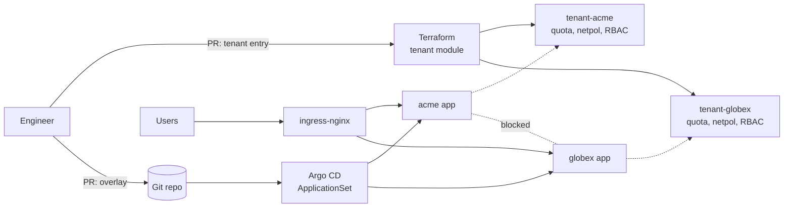

  
# Multi-Tenant Kubernetes Platform

A small, real platform that hosts several customers ("tenants") on one Kubernetes cluster while keeping them isolated from each other. Terraform onboards each tenant with its own namespace, resource quota, network policies, and RBAC. Argo CD then deploys each tenant's app from a Kustomize overlay, so onboarding a new customer is two small pull requests.

This is **Stage 1** of a larger platform project. Later stages add a Go service, Vault secrets, policy-as-code, OpenTelemetry SLOs with error budgets, and chaos tests.

## What it shows

| Problem | How this repo handles it |
|---|---|
| One noisy tenant starves the rest | `ResourceQuota` and `LimitRange` per tenant, sized by tier (standard or premium) |
| Tenants can reach each other's pods | Default-deny `NetworkPolicy`; only same-tenant traffic, DNS, and the ingress controller are allowed |
| Tenants run privileged containers | Pod Security Admission set to `restricted` on every tenant namespace |
| Tenant admins see too much | Each tenant's SSO group is bound to `admin` inside its own namespace only |
| Apps deploy into the wrong place | Argo CD `AppProject` limits tenant apps to `tenant-*` namespaces and blocks them from editing quotas or network policies |
| Onboarding is manual | One Terraform map entry plus one Kustomize overlay; an `ApplicationSet` picks the overlay up automatically |

## Architecture



More detail, including how this maps to EKS, is in [docs/architecture.md](docs/architecture.md).

## Repo layout

```
terraform/
  modules/tenant/        # one tenant = namespace, quota, limits, netpols, RBAC, service account
  envs/local/            # tenants.auto.tfvars lists every tenant
apps/tenant-app/
  base/                  # hardened Deployment, Service, Ingress, PDB, HPA
  overlays/<tenant>/     # per-tenant namespace, host, and sizing
argocd/                  # AppProject + ApplicationSet (one app per overlay)
kind/cluster.yaml        # 3-node local cluster with ingress ports
.github/workflows/ci.yaml
```

## Run it locally (free, about 10 minutes)

Needs Docker, [kind](https://kind.sigs.k8s.io/), kubectl, Terraform 1.6+, kustomize, and kubeconform.

```bash
make up        # kind cluster, ingress-nginx, Argo CD, tenants, apps
make test      # each tenant answers on its host; cross-tenant traffic is blocked
make down      # delete the cluster
```

Then open http://acme.localtest.me and http://globex.localtest.me (`localtest.me` resolves to 127.0.0.1).

## Onboard a new tenant

1. Add an entry to `terraform/envs/local/tenants.auto.tfvars`:
   ```hcl
   initech = {
     tier        = "standard"
     admin_group = "tenant-initech-admins"
   }
   ```
2. Copy `apps/tenant-app/overlays/globex` to `apps/tenant-app/overlays/initech` and change the namespace, host, and text.
3. `make tenants`, then push. Argo CD creates `tenant-app-initech` on its own.

## CI

Every pull request runs:

- `terraform fmt` and `terraform validate`
- `kustomize build` for every overlay, validated by `kubeconform` against Kubernetes 1.30 schemas
- `kubeconform` on the Argo CD manifests against the Argo CD CRD schemas
- Trivy config scan for Terraform and Kubernetes misconfigurations (fails on HIGH or CRITICAL)

## Roadmap

- [x] Stage 1: multi-tenant namespaces, quotas, network isolation, RBAC, GitOps per tenant
- [ ] Stage 2: replace the placeholder app with a small Go status API and a Spring Boot service
- [ ] Stage 3: Vault + External Secrets, OPA Gatekeeper policies, signed images
- [ ] Stage 4: OpenTelemetry tracing, Prometheus SLOs, error-budget burn-rate alerts
- [ ] Stage 5: chaos experiments (pod kill, latency, disk fill) with post-mortems
